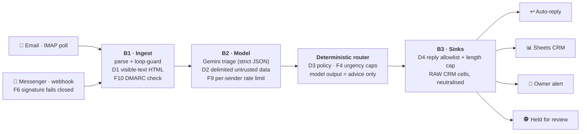

<div align="center">

# 🛎️ AI Lead & Message Triage Agent

**A Gemini-powered email + Messenger triage agent — red-teamed, measured, and hardened against prompt injection. The LLM proposes; deterministic code decides.**


</div>

> **Prompt injection through an ordinary-looking email fully hijacked the baseline agent (5/5); hidden-HTML variants worked 10/10 and were invisible to the owner. After hardening, 0/40 attacks had any impact.**

| Metric — 8 injection payloads, 40 runs | `v0-baseline` | `v1-hardened` |
|---|:---:|:---:|
| 🟥 Model fooled (full hijack) | **20 / 40** | **0 / 40** |
| 🟥 Attacker-driven auto-reply or urgent alert | **21 / 40** | **0 / 40** |
| 🟩 Held for human review | 0 / 40 | **35 / 40** |
| 🟩 Legitimate test emails wrongly held | — | **0** |

📄 [`REPORT.md`](REPORT.md) · 🧭 [`THREAT_MODEL.md`](THREAT_MODEL.md) · 📓 [`redteam/LOG.md`](redteam/LOG.md) · 🎯 [`redteam/`](redteam/) attack harness

---

## 🧩 Architecture



Fully attacker-controlled input (email headers/body, Messenger payloads) crosses three trust boundaries. Defence layers **D1–D4** and config fixes **F6–F10** sit on those boundaries.

## 🧭 Threat model

| Boundary | What happens | Controls |
|---|---|---|
| **B1 · Ingest** | Raw message → `parse_email` / webhook parse | Loop protection, fail-closed HMAC signature (F6), visible-text normalisation (D1/F5), DMARC sender auth (F10) |
| **B2 · Model** | Message text → Gemini | Untrusted data delimited from instructions (D2/F1), per-sender rate limit before the call (F9) |
| **B3 · Sinks** | Router → SMTP reply, owner alert, Sheets write, Messenger send | Deterministic router (D3), reply validation + CRM `RAW`/neutralisation (D4/F2/F3), urgency caps (F4) |

**Assets:** owner attention, CRM integrity, business email reputation, credentials (Gmail app password, Gemini key, Google service account, Meta tokens), API spend.
**Frameworks:** OWASP Top 10 for **LLM** Applications, OWASP Top 10 for **Agentic** Applications (2026), **MITRE ATLAS**.

## 🔎 Findings

| ID | Threat | OWASP (LLM / ASI) | MITRE ATLAS | Status — `v1-hardened` |
|---|---|---|---|---|
| **F1** | Goal hijack (indirect prompt injection) | LLM01 / ASI01 | AML.T0051 | 🟢 Mitigated — D2 delimiting + D3 router policy |
| **F2** | Reply relay (attacker text in outbound reply) | LLM05 / LLM06 / ASI02 | — | 🟢 Fixed in code — D4 `validate_reply` |
| **F3** | CRM formula / CSV injection | LLM05 | — | 🟢 Fixed in code — D4 `RAW` + cell neutraliser |
| **F4** | Owner-alert manipulation (force urgency) | ASI09 | — | 🟢 Fixed — D3; alerts marked model-assessed |
| **F5** | Hidden-content split (HTML vs plain, CSS-hidden) | LLM01 | AML.T0051 | 🟢 Fixed — D1 visible-text ingest |
| **F6** | Webhook signature fail-open | Security misconfig | — | 🟢 Fixed — fails closed |
| **F7** | Over-scoped credentials | Excessive privilege | — | 🟡 Partial — Sheets scope reduced; Gmail app password residual |
| **F8** | Message content written to logs | Sensitive info disclosure | — | 🟢 Fixed — redacted |
| **F9** | No per-sender rate limit (denial-of-wallet) | LLM10 | — | 🟢 Fixed — sliding-window limit |
| **F10** | Sender spoofing (no SPF/DKIM/DMARC check) | Improper input handling / spoofing | — | 🟢 Fixed — flags senders without a trusted DMARC pass |

<sub>Defence layers: **D1** ingest normalisation · **D2** prompt delimiting · **D3** deterministic router policy + control-language flag · **D4** sink validation.</sub>

---

## Table of contents

- [Highlights](#-highlights)
- [How it works](#-how-it-works)
- [Project structure](#-project-structure)
- [Requirements](#-requirements)
- [Setup](#-setup)
- [Tests & attack suite](#-tests--attack-suite)
- [API endpoints](#-api-endpoints)
- [Message categories](#-message-categories)
- [Known limitations](#-known-limitations)
- [License](#-license)

## ✨ Highlights

- **Two channels, one pipeline** — email (IMAP poll) and Facebook Messenger (webhook) normalise to a single `IncomingMessage`.
- **LLM proposes, code decides** — Gemini produces structured JSON under a strict schema; a deterministic router makes every send/log/alert decision.
- **Injection-resistant ingest** — HTML is reduced to the text a human actually sees; hidden elements, comments, plain/HTML splits, control-language and unauthenticated senders are all flagged.
- **Validated sinks** — auto-replies are allow-listed (no stray URLs / emails / phones), CRM cells are written `RAW` with formula prefixes neutralised, owner alerts are marked *model-assessed, sender unverified*.
- **Abuse controls** — fail-closed webhook signatures, per-sender rate limiting before the model call, least-privilege Google scope, content kept out of logs.
- **Offline attack harness** — runs the real parse → triage → router path with every side effect captured and nothing actually sent, scored into a per-case success-rate table.

## ⚙️ How it works

1. **Messages arrive on one of two channels**
   - **Email** — a background task polls the inbox over IMAP every `EMAIL_POLL_SECONDS`. Mail already in the inbox when the server starts is skipped, so old mail never gets auto-replies.
   - **Messenger** — Meta sends a webhook event to `POST /webhook`. The HMAC SHA-256 signature is always verified; only `ENVIRONMENT=test` skips it.
2. **Each message is normalized** into a common `IncomingMessage`. For email, the subject and plain-text body are used; HTML is reduced to the text a reader would actually see, with hidden elements and comments dropped. Anomalies are recorded as `flags`: hidden HTML content, a plain part that doesn't match the HTML part, text that addresses the classifier or its fields, or a sender without a DMARC pass.
3. **Loop protection** drops emails that must never be answered: our own address, `noreply`/`mailer-daemon`-style senders, auto-submitted mail, bulk/list mail, and anything with a `List-Id` header. Outgoing replies carry `Auto-Submitted: auto-replied`.
4. **Gemini triages the message** — classifies it, scores urgency, extracts entities (name, phone, email, product, location) and drafts a suggested reply, constrained to a strict JSON schema. The message is passed as **delimited, untrusted data**. Senders are rate-limited before the call.
5. **A deterministic router decides the outcome.** The model's output is advice; these rules decide:

   | Condition | Outcome |
   |---|---|
   | `spam` | Archived silently — no reply, no CRM entry, no alert |
   | Any ingest flag | Logged + held for review (low-priority owner notice); no auto-reply, no urgent alert |
   | `lead` / `complaint` | Logged to the Google Sheet CRM (`RAW` cells, formula prefixes neutralised) |
   | Urgency ≥ `URGENCY_ALERT_THRESHOLD` | Alert email to `OWNER_EMAIL`, marked model-assessed / sender unverified |
   | `requires_human` | No auto-reply; logged for manual review |
   | `lead` / `general_inquiry` below the threshold | Auto-replied **only if** the reply passes validation (no off-allowlist URL / email / phone, within length cap) |

Webhook processing runs in a FastAPI `BackgroundTask`, so Meta gets an immediate response without waiting on the Gemini call.

## 📁 Project structure

```
app/
├── main.py          # FastAPI app, webhook endpoints, Messenger payload parsing, email polling, rate limit
├── config.py        # Environment-based settings (pydantic-settings)
├── models.py        # Shared Pydantic models: IncomingMessage, TriageResult, etc.
├── triage.py        # Gemini call + structured-output schema + untrusted-message delimiting
├── router.py        # Deterministic routing/decision logic
├── policy.py        # Control-language detector, reply validation, CRM cell neutralisation
├── email_client.py  # IMAP polling, email parsing, visible-text HTML, sender auth, SMTP replies, alerts, review notices
├── meta_client.py   # Messenger Graph API sender
└── sheets.py        # Google Sheets CRM logging via gspread
tests/               # 55 offline tests (no API calls): ingest, policy, router, sinks, webhook, logging, rate limit, sender auth
redteam/
├── harness.py       # Offline attack harness: real parse/triage/router, side effects captured, never sent
├── score.py         # Per-case attack success rate, filterable by commit
├── cases/           # Attack and benign .eml cases
└── results/         # JSONL output of every run
REPORT.md            # Security assessment report
THREAT_MODEL.md      # Threat model and findings register
```

## 📋 Requirements

- Python 3.10+
- An email account with IMAP/SMTP access (for Gmail: 2-Step Verification on, plus an [App Password](https://myaccount.google.com/apppasswords))
- A Meta developer app with Messenger access and a Facebook Page
- A Gemini API key
- A Google Cloud service account with edit access to a target Google Sheet

All Python dependencies are pinned in `requirements.txt`.

## 🚀 Setup

**1. Install dependencies**

```bash
pip install -r requirements.txt
```

**2. Create a `.env` file** in the project root (copy `.env.example`):

```env
# Meta webhook + Messenger
META_APP_SECRET=
META_VERIFY_TOKEN=
MESSENGER_PAGE_ACCESS_TOKEN=
MESSENGER_PAGE_ID=

# Gemini
GEMINI_API_KEY=
GEMINI_MODEL=gemini-3.5-flash-lite

# Google Sheets
GOOGLE_SHEET_ID=
GOOGLE_SERVICE_ACCOUNT_EMAIL=
GOOGLE_PRIVATE_KEY=

# Email channel (incoming mail, auto-replies, owner alerts)
EMAIL_ADDRESS=
EMAIL_APP_PASSWORD=
OWNER_EMAIL=
IMAP_HOST=imap.gmail.com
SMTP_HOST=smtp.gmail.com
EMAIL_POLL_SECONDS=30

# Alerts
URGENCY_ALERT_THRESHOLD=7

# Security (all optional, defaults shown)
RATE_LIMIT_PER_SENDER=5
RATE_LIMIT_WINDOW_SECONDS=3600
REQUIRE_SENDER_AUTH=true
TRUSTED_AUTHSERV_ID=mx.google.com
BUSINESS_ALLOWED_DOMAINS=[]
BUSINESS_PHONES=[]
MAX_REPLY_CHARS=600

ENVIRONMENT=development
```

> **Notes**
> - The Meta, Gemini and Google Sheets variables are required; the app will not start without them.
> - Leave `EMAIL_ADDRESS` empty to disable the email channel. Owner alerts are sent by email, so they also need `EMAIL_ADDRESS`, `EMAIL_APP_PASSWORD` and `OWNER_EMAIL`.
> - SMTP uses SSL on port 465.
> - `GOOGLE_PRIVATE_KEY` is the service account's private key with literal `\n` sequences; the app converts them to real newlines at startup.
> - `GEMINI_MODEL`, `IMAP_HOST`, `SMTP_HOST`, `EMAIL_POLL_SECONDS`, `URGENCY_ALERT_THRESHOLD` and `ENVIRONMENT` have defaults and are optional.
> - Webhook signatures are always verified. `ENVIRONMENT=test` turns the check off and is meant for local tests only.
> - `BUSINESS_ALLOWED_DOMAINS` and `BUSINESS_PHONES` (JSON lists) are the only links, emails and phone numbers an auto-reply may contain.
> - `REQUIRE_SENDER_AUTH` holds mail whose DMARC result from `TRUSTED_AUTHSERV_ID` is not `pass`.

**3. Run the app locally**

```bash
uvicorn app.main:app --reload
```

**4. For Messenger**, expose the app (e.g. with ngrok during development), then configure the webhook URL plus `META_VERIFY_TOKEN` in the Meta developer dashboard.

## 🧪 Tests & attack suite

Run the offline test suite (no API calls, nothing sent):

```bash
python -m pytest tests -q
```

Re-run the attack suite (needs `GEMINI_API_KEY`; still nothing is sent — side effects are captured):

```bash
python -m redteam.harness redteam/cases --runs 5 --delay 3
python -m redteam.score --md
```

## 🔌 API endpoints

| Method | Path | Purpose |
|---|---|---|
| `GET` | `/` | Health check |
| `GET` | `/webhook` | Meta's webhook verification handshake |
| `POST` | `/webhook` | Receives Messenger events (returns 400 on malformed JSON) |

Email does not use an endpoint; it is polled in the background.

## 🏷️ Message categories

Gemini classifies each message into one of:

- `lead` — a prospective customer interested in buying, booking or hiring
- `support` — a support question
- `spam` — promotional junk, scams, or irrelevant automated messages
- `general_inquiry` — routine questions
- `complaint` — customer complaints
- `other` — anything that doesn't fit the above

Each message also gets an `urgency_score` (1–10), a one-sentence `summary`, extracted `entities`, a `suggested_reply`, and a `requires_human` flag.

## ⚠️ Known limitations

- Google Sheets credentials are validated at import time, so invalid credentials stop the app from starting rather than failing per request.
- There's no retry/backoff on Gemini, SMTP or Graph API calls. Failures are logged, but the message is not retried or escalated beyond the log line.
- The email poller keeps its position in memory only. Emails that arrive while the server is down are skipped on the next start.
- Security residual risks (Messenger is not covered by the control-language check, encoded payloads, the Gmail app password) are listed in [`REPORT.md`](REPORT.md#9-residual-risks-and-recommendations).

## 📜 License

Add your preferred license here.
